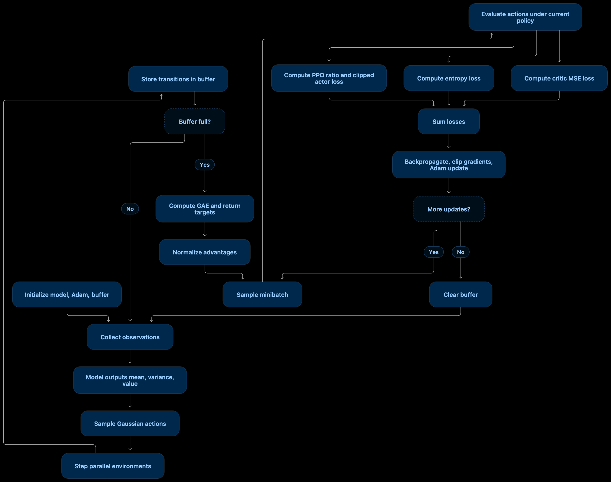

# PPO for Continuous Actions — Code Summary

The implementation has two main classes:

- `PPOAgentContinuous` — interacts with the environment, samples actions, coordinates training, computes losses, and updates the neural network.
- `TrajectoryBufferContinuous` — stores rollout data and calculates returns and advantages for training.

The neural network itself is supplied externally through the `Model` argument, so the agent does not depend on a particular network architecture.

Logger code is omitted below, as requested.

## 1. How the classes connect

Environment (`envs`)

Observations, rewards, terminated / truncated flags

`PPOAgentContinuous`

Calls the model, samples Gaussian actions, steps the environment

`Model` (provided externally)

Outputs policy mean, policy variance, and state value

`TrajectoryBufferContinuous`

Stores rollout data; computes GAE, returns, and normalized advantages

PPO training in `PPOAgentContinuous._training()`

Re-evaluates actions, calculates actor / entropy / critic losses, updates model

Updated model → next rollout

The important design choice is that the actor and critic share the same `Model` and optimizer. They may have separate network heads, but their exact architecture is defined outside these files.

### Responsibilities of each class

| Component                                    | Main responsibility                                                                                 |
| -------------------------------------------- | --------------------------------------------------------------------------------------------------- |
| `PPOAgentContinuous.__init__`                | Reads environment dimensions, creates the model, optimizer, and buffer                              |
| `PPOAgentContinuous.step`                    | Gets policy outputs, samples actions, steps environments, stores transitions, and triggers training |
| `PPOAgentContinuous._training`               | Computes PPO losses and performs gradient updates                                                   |
| `PPOAgentContinuous._sample_actions`         | Samples continuous actions from a Gaussian distribution                                             |
| `PPOAgentContinuous._log_prob`               | Computes the joint log-probability of an action                                                     |
| `TrajectoryBufferContinuous.add`             | Stores states, actions, old policy parameters, values, rewards, and done flags                      |
| `TrajectoryBufferContinuous.compute_returns` | Computes GAE-based advantages and return targets; normalizes advantages                             |
| `TrajectoryBufferContinuous.sample_batch`    | Samples random training examples                                                                    |
| `TrajectoryBufferContinuous.clear`           | Resets the rollout buffer after training                                                            |

## 2. The continuous-action policy

For each observation \\(s_t\\), the model returns:

- \\(\mu\_\theta(s_t)\\): Gaussian policy mean for each action dimension.
- \\(\sigma\_\theta^2(s_t)\\): Gaussian policy variance for each action dimension.
- \\(V\_\theta(s_t)\\): estimated value of the current state.

The policy is a diagonal Gaussian:

\\[ \pi\_\theta(a_t\mid s_t) =\mathcal{N}\left(\mu\_\theta(s_t), \operatorname{diag}(\sigma\_\theta^2(s_t))\right) \\]

The action is sampled using:

\\[ a_t=\mu\_\theta(s_t)+ \sqrt{\sigma\_\theta^2(s_t)}\odot\epsilon, \qquad \epsilon\sim\mathcal{N}(0,I) \\]

This corresponds to `_sample_actions()`.

The variance output is variance, not standard deviation. Your code correctly takes its square root before multiplying by random Gaussian noise.

### Action log-probability

For a \\(d\\)-dimensional action, assuming independent Gaussian action dimensions:

\\[ \log\pi\_\theta(a\mid s)= \sum\_{i=1}^{d}\left[ -\frac{(a_i-\mu_i)^2}{2\sigma_i^2} -\frac12\log(2\pi\sigma_i^2) \right] \\]

This is implemented by `_log_prob()`.

Summing over action dimensions gives one log-probability per environment transition, which is what the PPO ratio requires.

Important: Gaussian sampling does not constrain actions to environment bounds. If your environment requires bounded actions, you need to ensure the policy output is transformed or clipped appropriately, while handling the log-probability consistently.

## 3. The training pipeline

Training happens in two phases: collect experience, then optimize the policy using that experience.

### Phase A — Collect a rollout

Each call to `step(states)`:

1. Converts observations from NumPy to PyTorch tensors and moves them to `device`.
2. Runs the model under `torch.no_grad()`, obtaining \\(\mu\\), \\(\sigma^2\\), and \\(V(s)\\).
3. Samples actions from the Gaussian policy.
4. Executes the actions using `envs.step(actions)`.
5. Stores the observations, policy parameters, values, actions, rewards, and done flags in the buffer.
6. Calls `_training()` when the buffer reaches `n_ppo_steps`.

With \\(N\\) parallel environments and \\(T\\) rollout steps, one full buffer contains:

\\[ M=T\times N \\]

transitions, where \\(T=\texttt{n\\\_ppo\\\_steps}\\) and \\(N=\texttt{envs\\\_count}\\).

| Stored data                 | Why it is needed                                      |
| --------------------------- | ----------------------------------------------------- |
| `states`                    | Input to the model during training                    |
| `actions`                   | Actions whose probabilities are evaluated             |
| `actions_mu`, `actions_var` | Old policy distribution used as the PPO reference     |
| `values`                    | Critic estimates used in GAE                          |
| `reward`                    | Reward signal for estimating returns                  |
| `dones`                     | Prevents return propagation across episode boundaries |

The old policy parameters are essential: PPO compares the current policy against the policy that generated each action.

### Phase B — Compute returns and advantages

Once the buffer is full, `_training()` calls:

```
self.buffer.compute_returns(self.gamma, self.lam)
```

The buffer calculates advantages using Generalized Advantage Estimation (GAE).

First, calculate the temporal-difference residual:

\\[ \delta_t = r_t+\gamma(1-d_t)V(s\_{t+1})-V(s_t) \\]

where \\(d_t=1\\) indicates that the episode ended.

Next, accumulate discounted residuals backward through the rollout:

\\[ \hat A_t = \delta_t+\gamma\lambda(1-d_t)\hat A\_{t+1} \\]

Finally, compute the return target:

\\[ \hat R_t=\hat A_t+V(s_t) \\]

Here:

- \\(\hat A_t\\) estimates how much better or worse an action performed than expected.
- \\(\hat R_t\\) is the target against which the critic is trained.
- \\(\gamma\\) controls reward discounting.
- \\(\lambda\\) controls the bias–variance trade-off in GAE.

The implementation then normalizes advantages across the whole buffer:

\\[ \hat A_t \leftarrow \frac{\hat A_t-\operatorname{mean}(\hat A)} {\operatorname{std}(\hat A)+10^{-8}} \\]

This usually stabilizes actor updates by keeping the advantage scale more consistent.

Implementation caveat: your `_gae()` loop uses `reversed(range(buffer_size-1))`, which excludes the final rollout index. Consequently, the final timestep's advantage and return remain zero. Also, the implementation does not bootstrap from a value estimate of the observation after the rollout. These should be corrected for reliable training, especially at rollout boundaries.

## 4. How the PPO loss is computed

Each training batch runs through the current model again:

```
pi_mean, pi_var, values = self.model(states)
```

The new policy is evaluated on the exact actions collected earlier, and the actor, entropy, and critic losses are calculated separately.

### 4.1 Actor loss — clipped PPO objective

First, compute the log-probabilities under both policies:

\\[ \ell\_{\text{new}}=\log\pi\_\theta(a_t\mid s_t) \\]

\\[ \ell\_{\text{old}}=\log\pi\_{\text{old}}(a_t\mid s_t) \\]

Then calculate the probability ratio:

\\[ r_t(\theta)= \frac{\pi\_\theta(a_t\mid s_t)} {\pi\_{\text{old}}(a_t\mid s_t)} =\exp(\ell\_{\text{new}}-\ell\_{\text{old}}) \\]

Interpretation:

| Ratio       | Meaning                                                                |
| ----------- | ---------------------------------------------------------------------- |
| \\(r_t=1\\) | New and old policies assign the same probability density to the action |
| \\(r_t>1\\) | New policy assigns a higher density                                    |
| \\(r_t<1\\) | New policy assigns a lower density                                     |

The clipped surrogate objective is:

\\[ L^{\mathrm{CLIP}}(\theta)= \mathbb E_t\left[ \min\left( r_t\hat A_t,\\; \operatorname{clip}(r_t,1-\epsilon,1+\epsilon)\hat A_t \right)\right] \\]

Your code minimizes its negative:

\\[ \boxed{ L\_{\text{actor}}=-L^{\mathrm{CLIP}}(\theta) } \\]

```
p1 = ratio * advantagesp2 = torch.clamp(    ratio, 1.0 - self.eps_clip, 1.0 + self.eps_clip) * advantagesloss_actor = -torch.min(p1, p2).mean()
```

Why use `min` and clipping? They discourage the optimizer from gaining an excessive objective improvement by moving the policy too far from the policy that collected the data.

Clipping is not a strict constraint on the policy update; it limits the incentive provided by the surrogate objective.

### 4.2 Entropy loss — policy exploration

For a diagonal Gaussian, the policy entropy is:

\\[ H(\pi\_\theta)= \frac12\sum\_{i=1}^{d} \log(2\pi e\sigma_i^2) \\]

Your implementation averages this quantity across the batch and then negates it:

\\[ \boxed{ L\_{\text{entropy}}=-\beta H(\pi\_\theta) } \\]

```
entropy = (    0.5 * torch.log(2.0 * math.pi * math.e * pi_var)).sum(dim=1).mean()loss_entropy = -self.entropy_beta * entropy
```

Higher entropy generally corresponds to a more spread-out Gaussian policy. Since the optimizer minimizes the total loss, this negative term encourages higher entropy when `entropy_beta > 0`.

When `entropy_beta = 0`, entropy has no effect on training.

### 4.3 Critic loss — value prediction

The critic predicts \\(V\_\theta(s_t)\\). Its target is the return \\(\hat R_t\\) calculated by GAE.

\\[ \boxed{ L\_{\text{critic}}= c_v\\,\mathbb E_t \left[(V\_\theta(s_t)-\hat R_t)^2\right] } \\]

```
loss_critic = self.val_coeff * (    (returns - values.squeeze(1)) ** 2).mean()
```

The critic learns to estimate expected discounted future rewards. Better value estimates help produce better advantages for the actor.

### 4.4 Total loss and optimizer update

The three components are combined:

\\[ \boxed{ L\_{\text{total}}= L\_{\text{actor}}+ L\_{\text{entropy}}+ L\_{\text{critic}} } \\]

Then the model is updated using backpropagation:

```
self.optimizer.zero_grad()loss.backward()torch.nn.utils.clip_grad_norm_(    self.model.parameters(), self.max_grad_norm)self.optimizer.step()
```

The sequence is:

1. Clear gradients from the previous update.
2. Calculate gradients of the total loss.
3. Clip the global gradient norm.
4. Update model parameters using Adam.

Because the actor and critic use the same model and optimizer, gradients from all three losses contribute to the same parameter update. The exact extent of sharing depends on the externally defined `Model` architecture.

## 5. Hyperparameters explained

The constructor exposes the following main controls.

### PPO algorithm parameters

| Parameter       | Default | Purpose and effect                                                                                        |
| --------------- | ------- | --------------------------------------------------------------------------------------------------------- |
| `gamma`         | `0.99`  | Discount factor for future rewards. Higher values make the agent more farsighted.                         |
| `lam`           | `0.95`  | GAE parameter. Higher values generally reduce bias but increase variance in advantage estimates.          |
| `eps_clip`      | `0.2`   | PPO clipping threshold. The ratio is clipped to \\([0.8,1.2]\\) before computing the surrogate objective. |
| `adv_coeff`     | `1.0`   | Scales advantages before computing the actor loss. Usually left at `1.0`.                                 |
| `val_coeff`     | `0.5`   | Weight of the critic MSE loss relative to the actor loss.                                                 |
| `entropy_beta`  | `0.0`   | Weight of the entropy bonus. Zero disables the entropy contribution.                                      |
| `max_grad_norm` | `0.5`   | Maximum global gradient norm, limiting excessively large gradient updates.                                |

### Rollout and optimization parameters

| Parameter        | Default  | Purpose and effect                                                                                                             |
| ---------------- | -------- | ------------------------------------------------------------------------------------------------------------------------------ |
| `n_ppo_steps`    | `128`    | Number of environment steps collected per environment before training starts.                                                  |
| `batch_size`     | `1024`   | Number of transitions sampled for each gradient update.                                                                        |
| `n_ppo_episodes` | `4`      | Controls the number of minibatch updates indirectly. Despite its name, it is not the number of completed environment episodes. |
| `learning_rate`  | `0.001`  | Adam learning rate. Controls the size of optimizer updates.                                                                    |
| `device`         | `"cpu"`  | Device used by the model and training tensors.                                                                                 |
| `envs`           | Required | Vectorized environment interface providing observations, actions, rewards, and termination signals.                            |
| `Model`          | Required | Neural-network class that maps observations to policy mean, variance, and value.                                               |

### How `n_ppo_episodes` actually works

Your implementation calculates:

\\[ K=\left\lfloor \frac{E\\,N\\,T}{B} \right\rfloor \\]

where:

- \\(E\\) = `n_ppo_episodes`
- \\(N\\) = number of parallel environments
- \\(T\\) = `n_ppo_steps`
- \\(B\\) = `batch_size`
- \\(K\\) = number of gradient updates per rollout

For example, with the defaults and \\(N=8\\):

\\[ K=\left\lfloor \frac{4\times8\times128}{1024} \right\rfloor=4 \\]

This results in four optimizer updates after each rollout.

An important distinction: your `sample_batch()` uses `torch.randint`, which samples with replacement. Therefore, these are not conventional PPO epochs that shuffle and process every rollout sample once per epoch. Some transitions may appear multiple times in a batch, while others may not be sampled at all. If your intention is standard PPO epoch behavior, shuffle the rollout indices and iterate through minibatches without replacement.

### Practical tuning guidance

These are general starting points, not guaranteed optimal settings.

| If you observe…                                         | Consider…                                                                              |
| ------------------------------------------------------- | -------------------------------------------------------------------------------------- |
| Policy changes too aggressively or training is unstable | Lower `learning_rate`; consider lowering `eps_clip`                                    |
| Policy learns very slowly                               | Test a higher learning rate or more updates per rollout                                |
| Actions become too deterministic too early              | Increase `entropy_beta` slightly                                                       |
| Value estimates are poor                                | Check GAE and return handling; tune `val_coeff` if needed                              |
| Advantage estimates are noisy                           | Adjust `lam` and `gamma`; ensure terminal and rollout boundaries are handled correctly |
| Gradient updates are unusually large                    | Keep or lower `max_grad_norm`                                                          |
| Training is memory-heavy                                | Reduce `batch_size` or rollout size, while preserving sensible update counts           |

One particularly important detail is that `adv_coeff` is applied after the advantages have been normalized. It scales the actor objective but does not change the critic targets.

## 6. End-to-end training flow





## 7. Implementation details worth checking

Before relying on the implementation for longer training runs, I would prioritize these correctness checks.

1\. Final GAE timestep: fix the loop that excludes the last timestep, and correctly bootstrap from the next observation's value when a rollout ends without an episode termination.

2\. Termination versus truncation: `step()` combines `terminated` and `truncated` into `dones`. This prevents GAE propagation across both types of boundary. For time-limit truncations, it is often better to bootstrap from the final observation's value rather than treating them as true terminal states.

3\. Continuous action bounds: ensure sampled actions are valid for your environment. If you use clipping or a squashing transform, account for that consistently in the action probability calculation.

4\. Variance stability: ensure the model's variance output is strictly positive and numerically stable. A common approach is to predict a log standard deviation or log variance and constrain it appropriately.

5\. Loss reporting: the stored loss values are from the last minibatch update, not averages over all updates. This is fine for debugging, but it is important to understand when interpreting training curves.

6\. Batch count: if `batch_size` exceeds the rollout size, `num_batches` becomes zero and no optimization occurs. Choose rollout and batch sizes so that at least one update is performed.

## Summary

Your implementation follows the core PPO design:

- Policy: diagonal Gaussian for continuous actions.
- Value function: predicts state values through the supplied model.
- Experience collection: stores a fixed-size rollout across parallel environments.
- Advantage estimation: uses GAE with normalized advantages.
- Policy optimization: uses the clipped PPO surrogate loss.
- Exploration: optionally encouraged through Gaussian entropy.
- Value learning: uses mean squared error against return targets.
- Optimization: combines all losses, clips gradients, and updates the shared model with Adam.

The biggest conceptual point is that PPO learns by comparing the current policy with the policy that generated the stored actions, while using the critic to estimate whether those actions performed better or worse than expected. The clipping objective limits incentives for overly large policy changes, while GAE and the critic provide the learning signal.